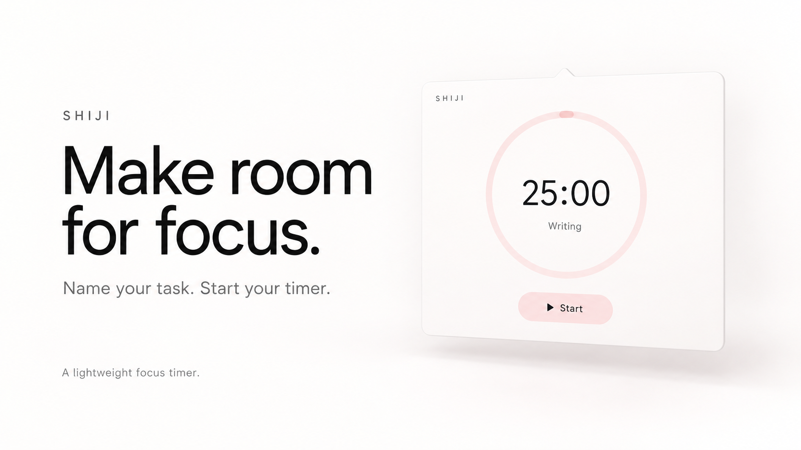
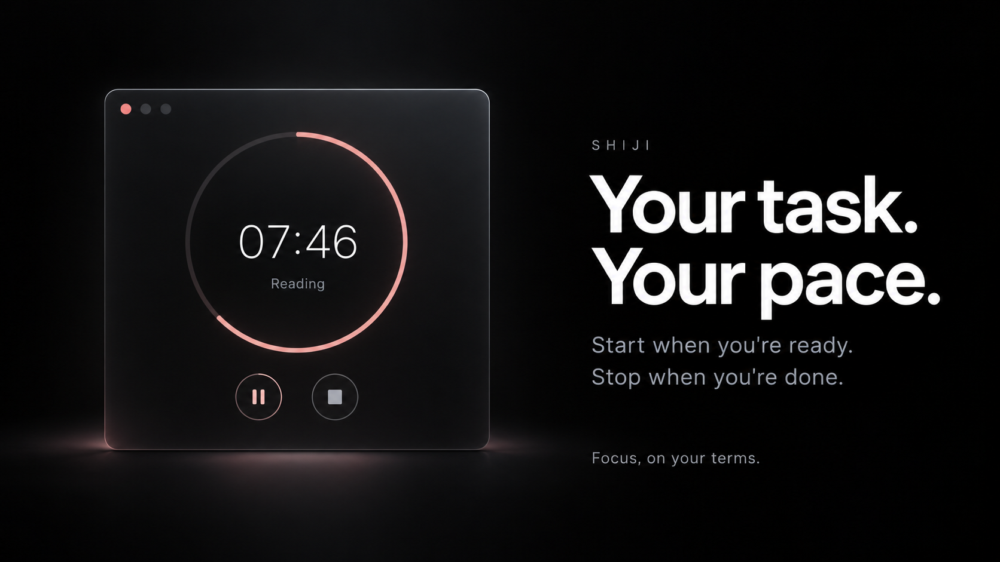
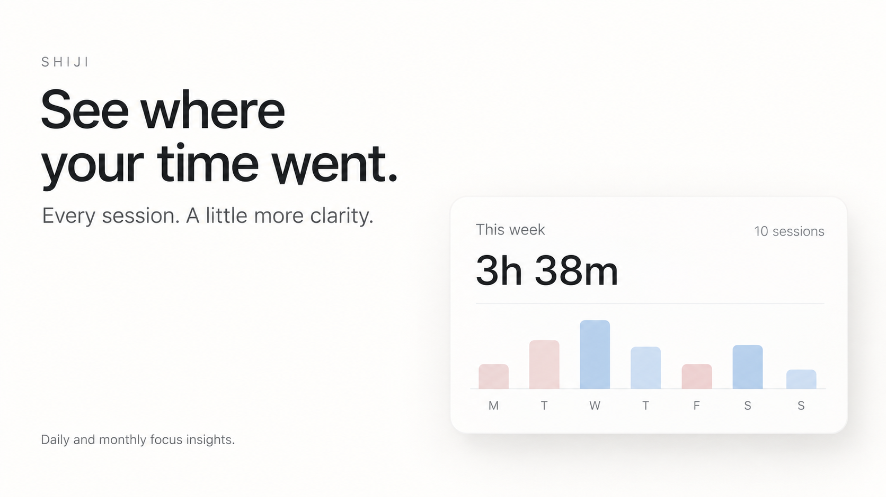

# Shiji · 时迹

### Make room for focus.

Name your task. Start when you're ready. Stop when you're done.
Then look back at where your time went.

A lightweight focus timer and personal time journal, built with plain HTML, CSS and JavaScript, with an experimental native macOS menu-bar companion.

[中文说明](README.zh-CN.md) · [Design announcement on X](https://x.com/DengShiqi0u/status/2115408449282757048)



> Early prototype. These AI-generated images explore the visual direction; they are not screenshots of the current app. The working interface is currently in Simplified Chinese.

## Your task. Your pace.

- **Task-based timing.** Give each session a name and category.
- **Countdown or count up.** Choose a focus duration, or use an open-ended timer.
- **Pause, resume, finish.** Stop manually to save the actual time spent. A countdown reaching zero does not automatically end the session.
- **A record of your day.** Browse completed sessions with names, timestamps and durations.
- **Daily, weekly, monthly and yearly insights.** Explore time distribution, session counts, active days and longest sessions.
- **Local storage.** Session data stays in the current browser profile or the macOS app's WebKit storage. No application backend or account is required.
- **JSON and CSV exports.** Back up or analyze your completed sessions from the web interface.



## Try it locally

Clone the repository and serve the static app with Python 3:

```sh
git clone https://github.com/Deng-Shiqi/shiji.git
cd shiji
python3 -m http.server 4173 --directory dist --bind 127.0.0.1
```

Open **http://127.0.0.1:4173** in your browser. Use the same address and browser profile to keep accessing your saved records. There is no npm install or frontend build step.

1. Enter a task, select a category and choose a duration or count-up mode.
2. Start your session; pause and resume as needed.
3. Stop to save it, then visit the timeline or insights tab.
4. Export JSON or CSV from preferences before clearing browser data.

## Experimental macOS app

The native companion uses Swift, AppKit and WebKit. It places a compact timer in the menu bar and opens the full interface from its gear button.

Requirements: macOS 13 or later and Xcode Command Line Tools with a compatible Swift compiler and macOS SDK.

```sh
xcode-select --install  # only if Command Line Tools are not installed
zsh native/build-macos.sh
open build/时迹.app
```

The script builds for your Mac's architecture by default. Override `TARGET_ARCH` with `arm64` or `x86_64`, or set `SDKROOT` to select a compatible SDK. The app is locally ad-hoc signed, not notarized; no prebuilt release is provided here.

Build verified on Apple Silicon with Swift 6.3.3 and macOS SDK 26.5. If the default SDK was built with a newer Swift compiler, select an installed compatible SDK, for example:

```sh
SDKROOT=/Library/Developer/CommandLineTools/SDKs/MacOSX26.5.sdk zsh native/build-macos.sh
```

- Click the menu-bar timer to show or hide the popover.
- **Gear:** open the full interface.
- **Pin:** keep the popover visible when clicking elsewhere.
- **×:** hide the popover. **⏻:** quit the app.

The app has no Dock icon. The desktop popover layout and input behavior remain experimental.

## See where your time went.



## Current limitations

- UI language is Simplified Chinese; English localization is welcome.
- The promotional visuals show a design direction, not feature-complete light/dark themes.
- Browser and desktop data do not sync with each other or across devices.
- Clearing site or app storage removes local records. JSON export exists; importing backups is not implemented.
- Summary charts attribute a session to its start time rather than splitting it across midnight or calendar boundaries.
- Periods other than a day currently label the average as a daily average, but calculate an average per session. Treat that figure as a per-session average until corrected.
- Changes from another window are not synchronized live; reload to refresh. This is a prototype, not a production time-accounting system.

## Project structure

```text
dist/
  index.html          Full web app: timer, timeline, insights, exports
  popover.html        Compact desktop timer and native message bridge
native/
  ShijiApp.swift      Menu bar, popover and main-window lifecycle
  Info.plist          macOS app metadata
  build-macos.sh      Local build and ad-hoc signing
docs/images/          Promotional design concepts
```

## Contributing

Issues and pull requests are welcome. Useful first contributions include English localization, more robust input handling in the macOS popover, accurate period averages, cross-day session allocation and JSON import.

For a change, describe what you tested. Useful manual checks: start → pause → resume → stop; refresh during an active timer; inspect an empty analytics period; export and inspect JSON/CSV. Never commit personal session exports, credentials, signing keys or local build outputs.

## License

[MIT](LICENSE). Copyright © 2026 Deng-Shiqi.
