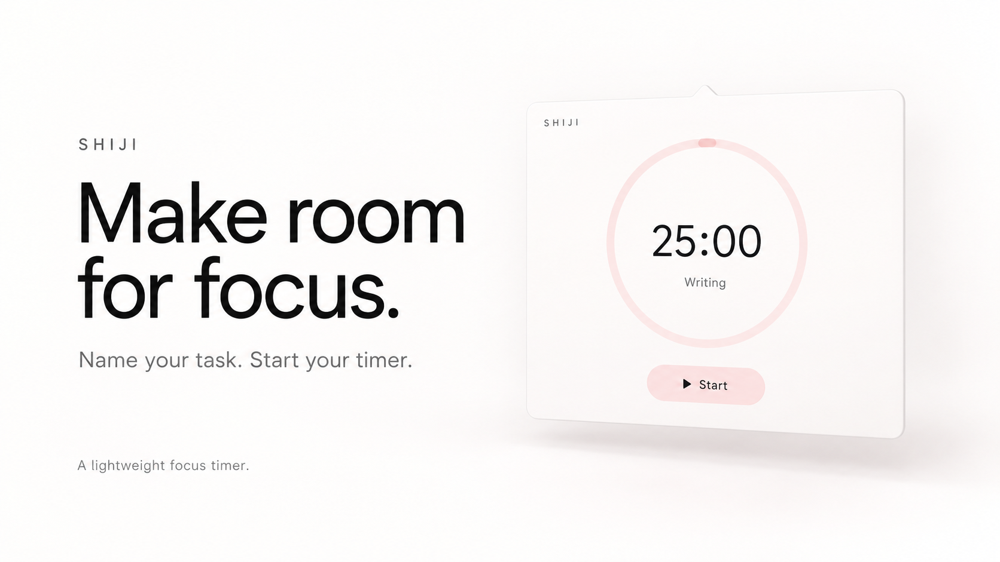

# 时迹 · Shiji

给专注留一点空间。

为任务命名，开始计时，完成后手动停止，再看看时间花在了哪里。



时迹是一个轻量的专注计时与时间记录原型。网页端采用原生 HTML、CSS、JavaScript；macOS 菜单栏版使用 Swift、AppKit 与 WebKit。

宣传图为 AI 生成的设计概念图，并非当前程序截图。当前可运行界面使用简体中文，桌面弹窗与输入行为仍处于实验阶段。

## 功能

- 自定义任务与分类，支持倒计时和自由正计时。
- 暂停、继续、手动停止并保存实际用时；倒计时归零后不会自动结束。
- 时间轴与日、周、月、年统计。
- 本地存储，无需应用账号或后端；网页端支持 JSON、CSV 导出。
- macOS 菜单栏计时与小窗固定显示。

## 本地运行

需要 Python 3：

```sh
git clone https://github.com/Deng-Shiqi/shiji.git
cd shiji
python3 -m http.server 4173 --directory dist --bind 127.0.0.1
```

浏览器打开 http://127.0.0.1:4173 。保持地址和浏览器配置一致，才能访问原来的本地记录。

## macOS 构建

需要 macOS 13+ 和包含兼容 Swift 编译器、macOS SDK 的 Xcode Command Line Tools：

```sh
xcode-select --install  # 已安装则跳过
zsh native/build-macos.sh
open build/时迹.app
```

默认针对当前 Mac 的架构构建，可用 `TARGET_ARCH` 指定 `arm64` 或 `x86_64`，用 `SDKROOT` 指定 SDK。构建仅使用本地临时签名，未经过 Apple 公证。

已在 Apple Silicon、Swift 6.3.3、macOS SDK 26.5 下验证编译。如果默认 SDK 版本高于编译器，请选择本机已安装的兼容 SDK，例如：

```sh
SDKROOT=/Library/Developer/CommandLineTools/SDKs/MacOSX26.5.sdk zsh native/build-macos.sh
```

菜单栏数字用于打开小窗；齿轮打开完整界面；图钉切换固定显示；× 收起小窗；⏻ 彻底退出。此应用没有 Dock 图标。

## 已知限制

- 网页、桌面以及不同设备之间不自动同步，多窗口需刷新读取最新记录。
- 清理浏览器或应用存储会移除数据，请先导出备份；尚未实现 JSON 导入。
- 跨天或跨月记录按开始时间归属，不拆分时长。
- 非日视图的“日均时长”目前实际计算单次平均时长，请按单次平均理解。
- 宣传图中的视觉风格并未完整实现，桌面版输入与弹窗布局还需要改进。

完整说明见 [English README](README.md)。欢迎提交 Issue 或 Pull Request。

## 许可证

[MIT](LICENSE)，© 2026 Deng-Shiqi。
